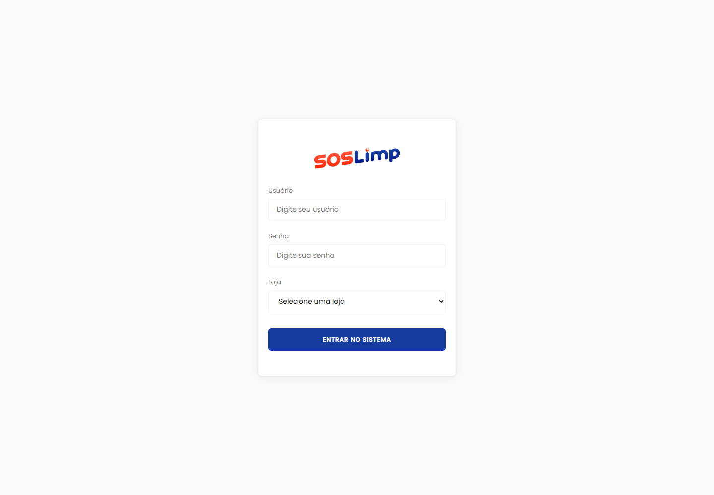
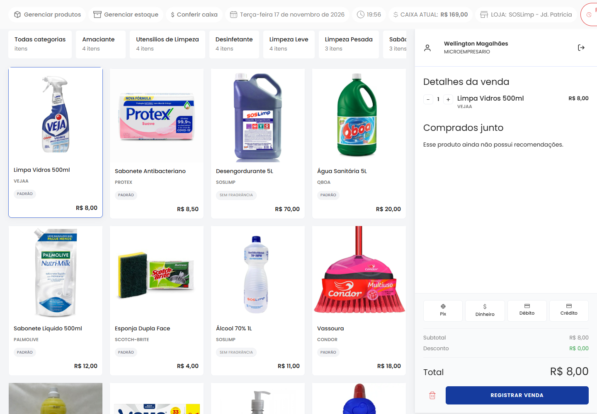
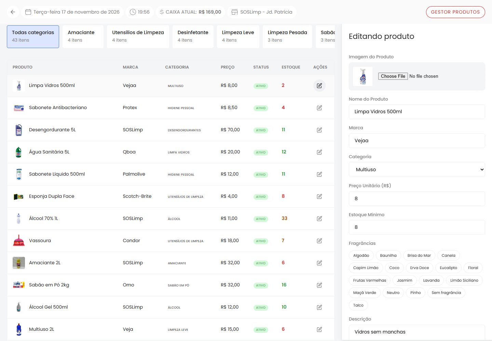
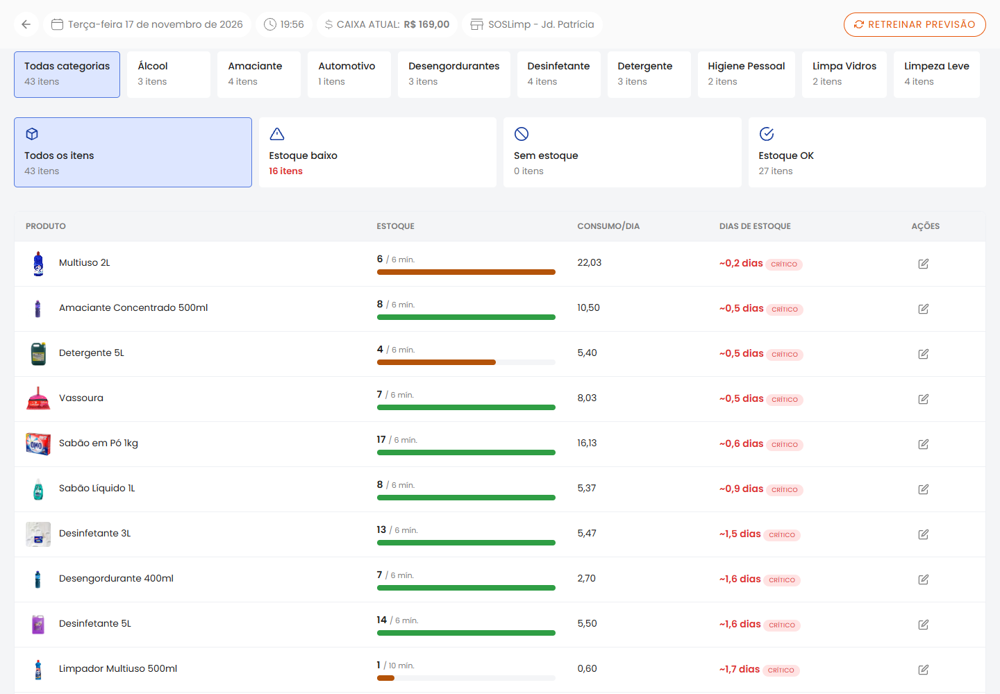
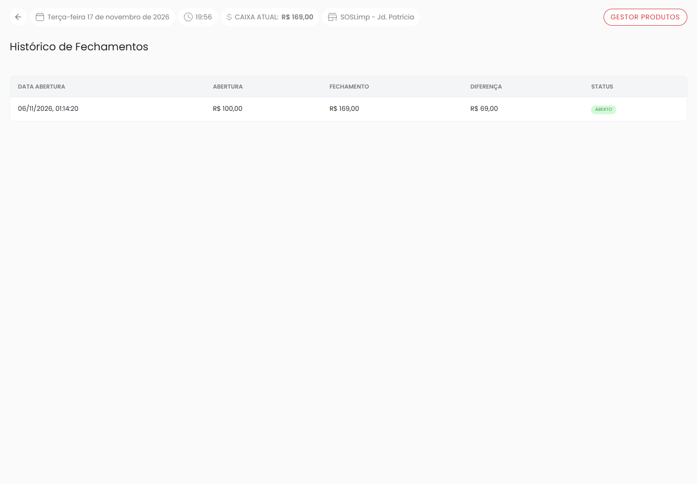
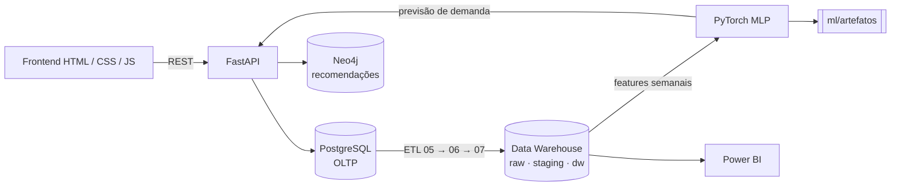
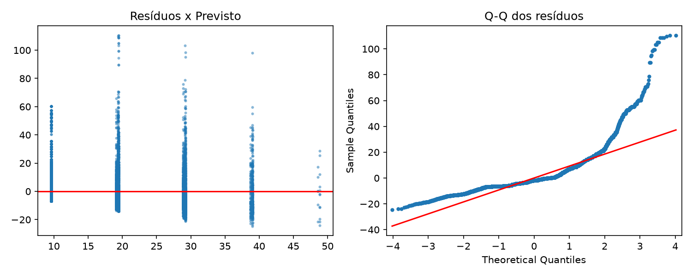

<p align="center">
  
</p>

# SOSLimp PDV

Sistema de Ponto de Venda (PDV) e gestão para a empresa fictícia **SOSLimp**, desenvolvido como Projeto Integrador do curso de **Big Data para Negócios** da **Fatec Ipiranga**. O projeto integra banco de dados transacional e analítico, banco de grafos para recomendações, dados sintéticos e modelos de aprendizado de máquina para previsão de demanda.

> **Projeto Integrador III — 3º semestre de 2026**
> Evolução do PDV construído no Projeto Integrador II, agora com Data Warehouse, controle de estoque e modelos preditivos.

## Sobre o Projeto

O SOSLimp PDV simula a operação de uma rede de lojas de produtos de limpeza. O sistema cobre o fluxo completo de venda — login do colaborador, abertura de caixa, seleção de produtos, recomendações, pagamento e baixa de estoque — e também a camada analítica, com Data Warehouse em esquema estrela, ETL, dashboards e previsão de ruptura de estoque.

O projeto foi pensado para aplicar, em uma lógica de negócio coesa, conhecimentos de:

- **Banco de dados relacionais** (PostgreSQL): modelagem OLTP, Data Warehouse, ETL em SQL, stored procedures e triggers.
- **Banco de dados de grafos** (Neo4j): relações entre vendas, produtos e fragrâncias para recomendações.
- **Estatística e probabilidade**: geração de dados sintéticos com sazonalidade e testes estatísticos nos experimentos.
- **Inteligência Artificial**: rede neural para previsão de demanda semanal e recomendações baseadas em grafo.
- **Engenharia de software**: API REST com FastAPI, separação em camadas, frontend web e Docker Compose.
- **Gestão de negócios**: estoque por loja, alertas de reposição, controle de caixa e visão gerencial.

## Funcionalidades

- **PDV**: catálogo por categoria, carrinho, seleção de fragrância, quatro formas de pagamento (Pix, dinheiro, débito e crédito) e cálculo de troco.
- **Recomendações**: sugestões de produtos comprados juntos, com base no histórico de vendas armazenado no Neo4j.
- **Gestão de produtos**: cadastro, edição, ativação/inativação, categorias, fragrâncias, preço e imagem.
- **Controle de estoque**: saldo por produto e por loja, estoque mínimo, ajustes manuais com motivo, movimentações e alertas de reposição.
- **Previsão de demanda**: consumo diário previsto, dias restantes de estoque, data estimada de ruptura e classificação de risco (`CRITICO`, `ATENCAO`, `OK`).
- **Caixa**: abertura, fechamento, conferência de valores e histórico de fechamentos.
- **Data Warehouse**: carga a partir do OLTP e base para dashboards no Power BI.
- **Bloqueio de venda sem estoque**: a venda é recusada quando não há saldo suficiente, com aviso ao operador.

## Telas do Sistema

<p align="center">
  
</p>

**PDV — catálogo, carrinho e recomendações**



**Gestão de produtos**



**Gestão de estoque com alertas e previsão de dias restantes**



**Histórico de caixa**



## Arquitetura



O frontend é estático e consome a API por HTTP. A API acessa o PostgreSQL via `psycopg2` e o Neo4j via driver oficial. O ETL recarrega o Data Warehouse a partir do OLTP e o modelo de previsão é treinado sobre esse DW.

## Tecnologias Utilizadas

**Backend**
- Python 3.12
- FastAPI + Uvicorn
- PostgreSQL 15 (`psycopg2`)
- Neo4j 5.26 (driver oficial Python)
- Docker / Docker Compose e pgAdmin

**Frontend**
- HTML5, CSS3 e JavaScript (sem framework)

**Dados, análise e IA**
- Pandas e NumPy
- PyTorch (rede neural MLP em produção)
- scikit-learn e statsmodels (scripts de experimentos)
- Matplotlib (gráficos de avaliação)
- Power BI (dashboards analíticos)

**Outras ferramentas**
- SQL e Cypher
- Git / GitHub

## Banco de Dados

### Modelo transacional (OLTP)

Entidades principais: `loja`, `colaborador`, `colaborador_login`, `colaborador_trabalha`, `categoria`, `produto`, `fragrancia`, `produto_fragrancia`, `forma_pagamento`, `registro_pedido`, `detalhes_pedido`, `caixa`, `movimentacao_caixa`, `estoque` e `movimentacao_estoque`.

### Data Warehouse (esquema estrela)

Criado nos schemas `raw`, `staging` e `dw`:

- **Fato**: `dw.fato_venda_item` (quantidade, preço praticado, valor total, flag de recomendação, turno e chaves estrangeiras).
- **Dimensões**: `dw.dim_tempo`, `dw.dim_produto`, `dw.dim_loja`, `dw.dim_colaborador` e `dw.dim_forma_pagamento`.

### Stored procedure e trigger

- `dw.sp_calcular_taxa_recomendacao(data_inicio, data_fim, cod_loja)`: calcula a proporção de itens vendidos por recomendação e grava em `dw.estatistica_recomendacao`.
- `trg_log_alteracao_preco`: trigger `AFTER UPDATE OF preco_unitario` em `produto`, que registra preço anterior, novo preço e variação percentual em `log_alteracao_preco`.

## Dados Sintéticos e Pipeline

Como o projeto não usa dados reais da empresa, as vendas são geradas por `backend/database/gerador/gerar_vendas.py`:

- **6 anos de histórico** (2020 a 2026), com seed fixa para reprodutibilidade.
- Duas lojas, sendo a segunda inaugurada em novembro de 2023, com curva de maturação.
- Sazonalidade (pandemia, férias escolares, feriados, dengue), temperatura, ciclos de pagamento e evolução do Pix.
- Aproximadamente **34 mil pedidos** e **43 mil itens**, incluindo vendas perdidas por falta de estoque.
- Saída em CSV: `registro_pedido`, `detalhes_pedido`, `movimentacao_estoque`, `estoque_final` e `vendas_perdidas`.

Os scripts de banco são executados em ordem pelo Docker na primeira inicialização:

| Script | Conteúdo |
| --- | --- |
| `01_estrutura_transacional.sql` | Tabelas OLTP, chaves e restrições |
| `02_dados_iniciais.sql` | Lojas, colaboradores, categorias, produtos e estoque inicial |
| `03_carregar_vendas.sql` | Carga dos CSVs sintéticos (`COPY`) |
| `04_estrutura_dw.sql` | Schemas `raw`, `staging`, `dw`, dimensões e fato |
| `05_carga_raw.sql` | OLTP → `raw` |
| `06_carga_staging.sql` | `raw` → `staging` (limpeza e padronização) |
| `07_carga_dw.sql` | `staging` → `dw` |
| `08_conferencia_carga.sql` | Conferência das cargas |
| `09_stored_procedure_trigger.sql` | Procedure de taxa de recomendação e trigger de auditoria de preço |

O módulo `backend/database/etl_dw.py` reexecuta os scripts `05`, `06` e `07` para atualizar o DW sob demanda — é o que acontece antes de cada retreino do modelo.

> Os CSVs não são versionados. Gere-os com o script do gerador antes de subir o banco pela primeira vez.

## Inteligência Artificial

### Recomendações (Neo4j)

As vendas alimentam um grafo com nós `Venda`, `Produto` e `Fragrancia`. As arestas `CONTEM` e `TEM_FRAGRANCIA` permitem sugerir produtos frequentemente comprados juntos. O frontend consulta a API ao adicionar itens ao carrinho.

### Previsão de demanda (PyTorch)

O modelo de produção é uma rede **MLP** (`backend/ml/modelo.py`) treinada para prever a quantidade vendida na próxima semana por produto e loja.

- **Entradas**: lags de 1 a 4 semanas, médias móveis de 4 e 12 semanas, sazonalidade semanal (seno/cosseno), preço e one-hot de produto, loja e categoria.
- **Rede**: 32 → 16 → 1 neurônios, ativação ReLU, otimizador Adam e perda MSE.
- **Avaliação**: holdout temporal das **8 semanas mais recentes**, com MAE e RMSE.
- **Artefatos**: `backend/ml/artefatos/modelo.pt` e `scaler.json` (normalização e metadados).
- **Uso na gestão**: a partir do consumo diário previsto, o sistema calcula dias restantes e a data estimada de ruptura.
- **Retreino**: `POST /previsao/treinar` recarrega o DW e treina o modelo; também disponível pelo botão “Retreinar previsão” na tela de estoque.

## Experimentos e Resultados

A pasta `backend/experimentos/` reúne os estudos que fundamentam as escolhas do projeto:

- `regressao_e_mlp_sklearn.py`: compara **Regressão Linear** e **MLPRegressor** (scikit-learn) com validação temporal em 5 folds, reportando MAE, RMSE e R².
- `validacao_baseline.py`: compara o MLP com um baseline de média móvel de 4 semanas no holdout de 8 semanas.
- `lab1.py` e `lab2.py`: amostragem, intervalo de confiança, teste t para o ticket médio e regressão linear múltipla do ticket em função da quantidade de itens e da presença de recomendação.
- `residuos.png`: análise gráfica de resíduos do modelo.



## Estrutura do Repositório

```text
soslimp/
├── backend/
│   ├── main.py                  # Aplicação FastAPI e CORS
│   ├── routes/                  # Endpoints por domínio
│   ├── services/                # Regras de negócio e consultas
│   ├── models/                  # Schemas Pydantic
│   ├── ml/                      # Dataset, rede MLP e artefatos
│   ├── experimentos/            # Estudos estatísticos e modelos comparativos
│   ├── database/
│   │   ├── conn_postgres.py
│   │   ├── conn_neo4j.py
│   │   ├── etl_dw.py
│   │   ├── gerador/gerar_vendas.py
│   │   └── gerar_banco/         # Scripts 01 a 09
│   ├── static/products/         # Imagens dos produtos
│   ├── docker-compose.yml
│   └── requirements.txt
├── frontend/
│   ├── index.html               # PDV
│   ├── login.html
│   ├── produtos.html
│   ├── estoque.html
│   ├── caixa.html
│   ├── css/
│   ├── js/
│   └── assets/
├── docs/img/                    # Capturas de tela do README
└── README.md
```

## Como Executar

### Pré-requisitos

- Python 3.12+
- Docker e Docker Compose
- Navegador e uma extensão de servidor estático (por exemplo, Live Server do VS Code)

### 1. Clonar e configurar o ambiente

```bash
git clone <url-do-repositorio>
cd soslimp/backend
python -m venv venv
```

Ative o ambiente virtual:

```bash
# Windows
venv\Scripts\activate

# Linux/macOS
source venv/bin/activate
```

Instale as dependências:

```bash
pip install -r requirements.txt
```

Crie `backend/.env` com as variáveis de conexão:

```env
DB_HOST=localhost
DB_PORT=5433
DB_USER=seu_usuario
DB_PASSWORD=sua_senha
DB_NAME=soslimp
NEO4J_USER=neo4j
NEO4J_PASSWORD=sua_senha
PG_EMAIL=seu_email@exemplo.com
PG_PASSWORD=sua_senha
```

### 2. Gerar os dados sintéticos

Os CSVs não estão no repositório e precisam existir antes da primeira carga:

```bash
python database/gerador/gerar_vendas.py
```

### 3. Subir os bancos

```bash
docker compose up -d
```

Na primeira execução, o PostgreSQL roda automaticamente os scripts `01` a `09`. Para recriar o banco do zero (apaga os dados):

```bash
docker compose down -v
docker compose up -d
```

### 4. Rodar a API

```bash
uvicorn main:app --reload
```

- API: `http://127.0.0.1:8000`
- Documentação interativa: `http://127.0.0.1:8000/docs`
- pgAdmin: `http://localhost:8080`
- Neo4j Browser: `http://localhost:7474`

### 5. Abrir o frontend

Sirva a pasta `frontend/` na porta **5500** (o CORS da API libera `localhost:5500` e `127.0.0.1:5500`). No VS Code, use o Live Server sobre `frontend/index.html`.

Credenciais de demonstração:

| Usuário | Senha | Cargo |
| --- | --- | --- |
| `well` | `1234` | Microempresário (acesso administrativo) |
| `carol` | `1234` | Vendedora |

### 6. Treinar o modelo de previsão

Com o banco carregado, clique em **Retreinar previsão** na tela de estoque ou execute:

```bash
curl -X POST http://127.0.0.1:8000/previsao/treinar
```

## Endpoints Principais

| Método | Rota | Descrição |
| --- | --- | --- |
| `GET` | `/autenticacao/lojas` | Lista lojas |
| `POST` | `/autenticacao/login` | Autentica colaborador e retorna token |
| `GET` | `/produtos/` | Lista produtos |
| `GET` | `/produtos/categorias` | Categorias com contagem de itens |
| `POST` | `/produtos/novo_produto` | Cadastra produto |
| `PUT` | `/produtos/atualizar/{cod_produto}` | Atualiza produto |
| `POST` | `/produtos/produtos_recomendados` | Recomenda produtos a partir do carrinho |
| `GET` | `/vendas/` | Lista vendas |
| `GET` | `/vendas/pedidos-do-dia` | Pedidos do dia |
| `POST` | `/vendas/novo_pedido` | Registra venda e baixa estoque |
| `GET` | `/estoque/{cod_loja}` | Estoque por loja |
| `GET` | `/estoque/alertas/{cod_loja}` | Produtos em alerta de reposição |
| `POST` | `/estoque/ajustar` | Ajuste manual de estoque |
| `POST` | `/estoque/minimo` | Define estoque mínimo |
| `GET` | `/caixa/{cod_loja}` | Caixa atual |
| `POST` | `/caixa/abrir-caixa` | Abre caixa |
| `POST` | `/caixa/fechar-caixa` | Fecha caixa |
| `GET` | `/caixa/historico/{cod_loja}` | Histórico de fechamentos |
| `POST` | `/previsao/treinar` | Recarrega o DW e treina o modelo |
| `GET` | `/previsao/estoque/{cod_loja}` | Previsão de todos os produtos da loja |
| `GET` | `/previsao/estoque/{cod_loja}/{cod_produto}` | Previsão de um produto |
| `GET` | `/recomendacoes/produto/{cod_produto}` | Recomendações de um produto |
| `POST` | `/recomendacoes/carrinho` | Recomendações para o carrinho |

## Limitações

- Projeto **acadêmico**: as senhas dos colaboradores são armazenadas em texto puro e o token é simplificado; não deve ser usado em produção.
- O modelo de previsão é global (todos os produtos e lojas em uma única rede) e não fornece intervalos de confiança.
- As recomendações dependem do histórico já registrado no Neo4j; um grafo vazio não gera sugestões.
- Os dados são sintéticos e o gerador usa parâmetros fixos para reprodutibilidade.
- Os dashboards do Power BI não estão versionados neste repositório.
- Não há suíte de testes automatizados; os scripts de experimentos e as validações do dataset (`assert`) funcionam como verificação.

## Equipe do Projeto

**Integrantes**

- Alisson Ibiapina da Silva — 2041382521023  


- **Instituição:** Fatec Ipiranga — Pastor Enéas Tognini
- **Disciplina:** Projeto Integrador III
- **Professora orientadora:** Roberta Kelly Bondade de Caldas Cavalcanti
